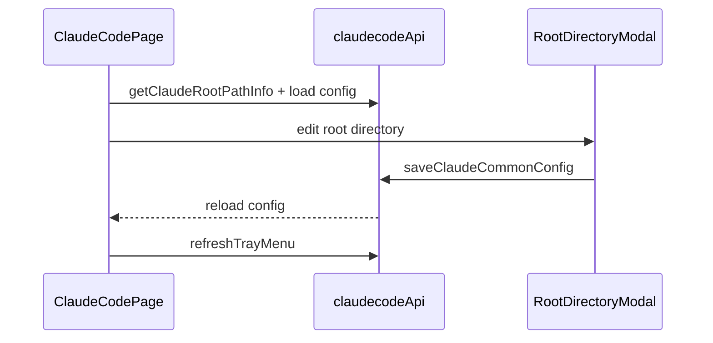

# Claude Code 前端模块说明

## 一句话职责

- `claudecode/` 页面负责 Claude Code provider/common config、根目录管理、prompt、plugin 与导入交互。

## Source of Truth

- 页面展示的根目录来源于后端 `getClaudeRootPathInfo()`，不是前端自己推导。
- Claude Code 页面管理的是根目录而不是单一配置文件路径；后续 `settings.json`、`CLAUDE.md` 等都从这个根目录派生。
- provider 的 `is_applied` 与运行时文件状态都以后台命令执行结果为准。
- 自定义 provider 的 Extra settings JSON 是 provider 记录的一部分，只在自定义渠道表单展示；官方订阅模式不展示也不写入额外字段。

## 核心设计决策（Why）

- 根目录编辑复用共享 `RootDirectoryModal` 和 `useRootDirectoryConfig`，确保 Claude/Codex 页面对 `custom/env/shell/default` 的解释一致。
- 导入 provider 时先做冲突检查，再决定覆盖或创建副本，避免直接把已有来源 provider 覆盖掉。
- 页面很多操作后都要主动 `loadConfig()` 和 `refreshTrayMenu()`，不能假设后端事件会自动把当前 React 状态改对。

## 关键流程

## 易错点与历史坑（Gotchas）

- 供应商卡片「CLI 启动」放在模型测试按钮后面，样式与模型测试一致；调用 `launchClaudeProviderCli` 用临时配置开终端，不改当前已应用状态。是否每次附加 `--dangerously-skip-permissions` 由顶部「更多选项」弹窗里的 Full Access 开关控制，偏好存应用 `AppSettings.claude_cli_launch_full_access`（SQLite），经 `settingsStore` 读写，不要用 localStorage。
- 「更多选项」里的「首选终端」是共享 `SettingsSelectRow`（仅 Windows 显示，用 `platform() === 'windows'` 判断），存全局 `AppSettings.preferred_terminal`（`cmd`/`powershell`/`wt`/`gitbash`），经 `settingsStore.setPreferredTerminal` 持久化。「CLI 启动」时从 settingsStore 读出并作为 `terminal` 参数传给 `launchClaudeProviderCli`；「所选终端不可用回退系统默认」的语义在后端处理（含 Git Bash 未安装时回退 cmd），前端不要自行探测终端可用性。
- Claude「更多选项」走共享 `SidebarSettingsModal` + `SettingsToggleRow`：Modal 内扁平分割列表（行间细线），不套圆角 elevated 卡片。左侧 `标题 + 独立一行 10px 辅助说明`，右侧仅 Switch。其他 CLI（Codex/OpenCode/Grok/Gemini/Pi/OpenClaw）共用同一组件。
- 不要把根目录编辑降级成“只改路径展示”；保存后真正会影响整个运行时文件派生。
- `sourceProviderId` 冲突必须先处理，不要新导入时直接无提示覆盖已有 provider。
- Optional 字段允许清空时，前端表单不要比后端存储模型更严格，否则会形成“能读不能存”的回归。
- 普通“新建 provider”和“复制已应用 provider”都应走普通创建语义，默认不自动应用；不要因为复制源当前已应用，就在提交对象或页面状态里把新记录当成已应用配置处理。
- 页面里的 `__local__` 不是普通新增 provider，而是当前生效本地配置的收编入口；当用户把它保存为正式 provider 时，产品语义是“把当前生效配置正式落库”，不是“基于当前配置再新建一个未应用草稿”。
- UI 上 `__local__` 即使后端 `isApplied=true`，也不要显示「已应用」标签、选中高亮或「应用」按钮；只保留本地来源提示。用户应通过编辑后保存收编入库，再进入正式 applied 管理语义。
- provider 模式只允许在空白新增 provider 时选择。模式入口并入表单顶部“渠道”选择行：空白新增可在“自定义/官方/内置渠道”之间切换；复制 provider 仍走创建新记录语义，但必须沿用源 provider 的 `category`；编辑已保存 provider 也必须保留既有 `category`，不要允许官方/自定义互相切换。
- 自定义模式下的内置供应商 endpoint 会填入 Base URL、API 格式和模型映射，但只锁定 API 格式，不锁定 Base URL；保存内置 endpoint 时只写 `meta.gatewayProfile={tool:"claude",profileId,endpointId}` 引用，`settingsConfig.env.ANTHROPIC_BASE_URL` 必须使用用户当前表单里的 Base URL。切回普通“自定义”时必须清掉 `gatewayProfile`，只保留用户手动选择的 `apiFormat`；不要把 `providerType` / `apiKeyField` / `reasoningField` / `defaultMaxTokens` / 图片策略这类 profile 派生快照写进 provider meta。
- Claude 内置 endpoint 如果提供完整 `models`，按 `primary` / `haiku` / `sonnet` / `opus` 写角色模型；如果只提供单个 `model`，添加供应商时要把它作为所有角色模型的兜底值，避免切到 OpenAI Chat 这类协议后模型映射区仍保留空值或旧值。
- Extra settings JSON 允许为空或 JSON object；保存时必须保留“用户清空”的语义，不能用 truthy 判断导致旧 extra settings 留在数据库或 settings.json 中。
- Extra settings 是高级可选配置，表单中默认折叠；编辑或复制已有非空 JSON object `extraSettingsConfig` 时必须自动展开，避免隐藏既有配置。
- 高级选项中的 `extraSettingsMergeStrategy` 是 provider 级字段，默认渠道配置覆盖通用配置；界面只展示行为描述，不展示参考项目名称。合并模式的说明必须明确对象递归合并、数组元素去重和标量冲突时的渠道优先级；旧 provider 缺失字段时回填默认值，官方订阅模式不展示该选项。编辑或复制非默认策略时即使 Extra settings JSON 为空也要自动展开高级选项，避免隐藏已保存策略。
- Claude provider 模型表单以 `settingsConfig.env.ANTHROPIC_*` 为新写入来源：兜底模型写 `ANTHROPIC_MODEL`，Sonnet/Opus/Fable/Haiku 角色模型分别写 `ANTHROPIC_DEFAULT_*_MODEL`，显示名称写 `ANTHROPIC_DEFAULT_*_MODEL_NAME`。前端仍要兼容读取旧顶层 `model` / `haikuModel` / `sonnetModel` / `opusModel` / `fableModel` / `reasoningModel`，但新表单不再提供 Reasoning 模型编辑入口，也不应新写 `ANTHROPIC_REASONING_MODEL`。旧 provider 或 endpoint 没有 Fable 字段时，前端表单保持 Fable 为空，不用 Opus 回填。
- 全部角色模型（Sonnet/Opus/Fable/Haiku）和默认兜底模型（`ANTHROPIC_MODEL`）的 1M 声明都不是独立布尔字段，只能通过模型 ID 末尾 `[1M]` 后缀表达；表单为四档角色和兜底模型提供独立 1M 开关，兜底模型输入时保留自身已有 1M 状态（与角色行一致），模型为空时开关不生效。模型输入框（角色行和兜底行）必须通过 `getValueProps` 只显示剥离 `[1M]` 后的 base，1M 状态完全由开关表达；如果让输入框显示完整存储值，用户在末尾退格或补字会与 `getValueFromEvent` 的重组逻辑相互作用，堆积出 `xxx[1M][1M]` 这类垃圾后缀（claudedesktop 角色行已按同一模式修复）。“一键设置”仍是取单个源模型覆盖所有角色；曾试验过独立的批量 1M 按钮（只切后缀不覆盖模型）后被裁掉，属有意简化，不要在没有新交互诉求时加回。Haiku 支持 1M 开关是有意偏离 cc-switch 的决策：官方 Claude Haiku 4.5 context window 只有 200K（1M 阵容是 Fable/Opus/Sonnet），cc-switch 因此把 Haiku 的 `supportsOneM` 设为 false；但 ai-toolbox 的 Haiku 档位大量用于第三方渠道映射任意上游模型，1M 是否生效由上游决定，所以保留开关。不要“对齐 cc-switch”把它改回 false。展示、收藏 provider 和连通性测试使用模型 ID 时要按场景剥离该后缀，不能把它当作真实上游模型名的一部分。注意 Claude Desktop 表单用的是 Claude Desktop 原生 `supports1m` schema 字段，与 `[1M]` 后缀机制不同源。
- Gateway 现在是 direct → single → failover 三态。single 入口在已应用 provider 卡片的“网关代理”按钮；single/failover 接管期间都必须锁定其他 provider 的“应用”入口，failover 时卡片额外显示 P0/P1 优先级，切 P0 必须先恢复直连。
- 插件页的全部启用/全部禁用只作用于“已安装”Tab 中 user scope 已安装插件；非 user scope 卡片仍只能提示当前不可直接操作，不要把批量入口扩展到 project/local/managed scope。
- **卡片视图（2026-10-11，issue #399）**：本页是 `shared/providerCardView` 的首个接入方。映射层（`ClaudeProviderCard.tsx`）加 `viewMode` 一个 prop，`'card'` 分支渲染 `ProviderCompactCard`——**两条分支共用同一份 `providerState` / `actions` / `nameTags`**，不要为卡片分支另算一套按钮条件。底部只放「CLI 启动」+「应用/网关代理」；列表卡片行内的「模型测试」在卡片视图里进「更多」菜单（`extraMenuItems`），位置变了但入口没丢。
- **详情侧栏（`ClaudeProviderDetailPanel.tsx`）是纯展示组件，由 `ClaudeProviderCard` 持有并渲染。** 卡片只放得下标题、角色模型行、两个主按钮；地址、全部角色绑定、备注和其余动作（测试/编辑/复制/分享/删除）都在侧栏里。侧栏**渲染的是与卡片同一对函数**（`renderProviderLaunchAction` / `renderProviderPrimaryAction`）和同一份 `gatewayActions`，所以「侧栏提供的能力与卡片一致」是结构性的。
  **布局（2026-10-12 用户指定）**：卡片那一行动作（CLI 启动 / 网关代理 / 应用）与状态标签**同一行**（`data-provider-detail-status`），footer 只留较安静的一排次要动作（`data-provider-detail-footer`）——主行动是「打开侧栏要做的事」，放在标题下方才不会在多档位供应商上被滚出视野。次要动作的 icon 与「更多」菜单取同一批（`EditOutlined` / `CopyOutlined` / `Share2` / `DeleteOutlined` / `ApiOutlined`），两个入口看起来是同一组动作而不是两份词表；footer 那一排走 11px（`.secondaryActions` 里作用到 `.ant-btn` 上），状态行那一排走 12px——两个高度不同的行各自定密度，**字号不要写进共享的按钮渲染函数**。
  **「连接信息」区（2026-10-12 用户指定）**：Base URL、**API 格式**、API Key 三行，顺序如此。API 格式由映射层算好（`apiFormatLabel` memo：`providerApiFormat` → `claudecode.provider.apiFormat*`，官方订阅返回 `null` 即整行不渲染），与 `GrokProviderCard` 同款。
  **key 不再打码。** 侧栏陈述完整 key（列表卡片那行的 `xxx…abcd` 是列表卡片的写法）：打码的 key 既不能拿去和供应商控制台核对也不能直接用，而侧栏本来就在一次刻意的点击之后。过长时用 `utils/middleEllipsis.ts` **从中间省略**成一行（保留头 25 / 尾 10——key 的两端都在传达身份：前缀说明签发方，尾巴是控制台里显示的那截），完整值走 `title` 悬停 + 旁边的复制按钮。Base URL 与 API Key 各有一个复制按钮（`data-provider-detail-copy`），点完 toast「已复制」。
  卡片主体点击开侧栏，但 `ProviderCompactCard` 的 `handleCardClick` 会过滤掉控件（button / a / input / menuitem / checkbox）——不加这层过滤，点「应用」也会盖上一层抽屉。
- **卡片视图下不再显示地址，但标题是来源链接**：标题后面曾挂 `baseUrl`，2026-10-11 移入侧栏的「连接信息」区（标题因此不再需要为长 URL 让位的 `max-width` 上限）；2026-10-12 起标题把 `baseUrl` 传给 `ProviderNameLink`，**悬停显示域名、点击用系统浏览器打开**，与列表卡片同款。
- **`nameTags` 拆成 `stateTags` + 各自的前缀**（2026-10-12）：列表卡片那行是 `localConfigHint + 地址 + stateTags`，卡片视图是 `localConfigHint + stateTags`（无地址）。两处共用同一棵 `stateTags` 子树（官方 / 绕过 / 已应用 / 代理 / P0）——用户报「卡片上的已应用标识没了」就是因为卡片视图过去只靠 accent 边框表达已应用。
- **卡片第二行 = 全部角色模型（2026-10-12 改）**：`resolveClaudeCardSubtitles`（`utils/claudeModelConfig.ts`）返回**所有已配置**的角色模型，顺序固定为 Opus → Sonnet → Haiku → Fable，没配的角色直接跳过（不留占位）。**不含**兜底模型（`ANTHROPIC_MODEL`）与 legacy Reasoning——那是列表卡片第二行的内容，卡片格子要的是「一眼看清各档位」，非档位的条目只会把档位挤掉。返回值是数组，空数组就是「不渲染第二行」。显示名优先（`ANTHROPIC_DEFAULT_*_MODEL_NAME`），否则用剥掉 `[1M]` 的模型 ID。角色的中文/英文标签走 `CLAUDE_CARD_ROLE_LABELS`（**全量 Record**，不是拼字符串——拼出来的 key 改错名会静默渲染成字面量）。
  此前有过「副标题显示哪个角色」的偏好设置 + 后端 `provider_card_subtitle_roles`，2026-10-12 随本次改动**连同后端字段/command 一起删除**：第二行列全部角色后，那个设置没了意义，留着就是死存储。

## 跨模块依赖

- 依赖共享 `RootDirectoryModal` / `useRootDirectoryConfig`。
- 页面头部用共享 `CodingPageHeader`（`shared/CodingPageHeader.tsx`，2026-10-07 迁移）。文案一律走 `common.*`，没有 per-CLI 覆盖 prop——迁移时删掉了 `claudecode.viewDocs` / `claudecode.configPath` / `claudecode.rootPathSource.customize` 三个孤儿 key，**英文措辞随之变化**（`Documentation` → `Official Docs`、`Configuration File Path` → `Config Path`、`Customize Root Directory` → `Customize Config Dir`），与 Codex 页此前的迁移口径一致。`claudecode.rootPathSource.modal.*` 仍在用（`RootDirectoryModal` 与 `ClaudePluginsPanel`），不要一起删。
- 供应商列表区用共享 `ProviderListSection`（`shared/ProviderListSection.tsx`），是本组件的试点（2026-10-06 迁移）。Claude Code 属于**不支持自定义模型**的形态，因此只传卡片列表、不渲染 `ModelListSection`。Gateway 的 Failover 胶囊走 `headerExtra`。改列表外壳时改共享组件，不要改回页面内联。
- 卡片用 `shared/providerCardVariants/ClaudeStyleCard`（2026-10-07 迁移），本模块只负责把 `settings_config` 映射成 `ProviderCardVariantProps`。角色绑定（默认/Haiku/Sonnet/Opus/Fable/Reasoning）走 `metaEntries` 的 `text` + `code` 交替项；连通性测试与「CLI 启动」走 `inlineActions`；网关五个按钮走 `actions.gatewayActions`（渲染在主操作**之前**）。映射层不得自己 `useSortable` / 自己渲染 `<Card>` / 自己写 `ManagementCheckbox`——`pnpm run test:provider-card-layout` 守护这条。
- 依赖后端 `claude_code::commands`、共享 favorite provider、All API Hub 导入组件，以及共享 `ImportFromCcSwitchModal`（CC Switch 只读导入；无 db 时不显示按钮）。
- 与 `settings/` 间接共享根目录来源和 WSL Direct 语义，但本页面自己只展示 `source/path`。

## 典型变更场景（按需）

- 改根目录交互时：
  同时检查 modal 回填只在 `source === custom` 时生效。
- 改 provider 导入/删除时：
  同时检查冲突处理、favorite provider 备份和 tray refresh。

## 最小验证

- 至少验证：修改根目录后重新加载页面能看到新的 path info。
- 至少验证：导入 provider 冲突时会进入冲突弹窗，而不是静默覆盖。
- 若本机存在 `~/.cc-switch/cc-switch.db`，Claude 页应出现「从 CC Switch 导入」；导入后 provider 带 `sourceProviderId=ccs:claude:...`、默认未应用；再次打开导入弹窗应标「已存在」。
